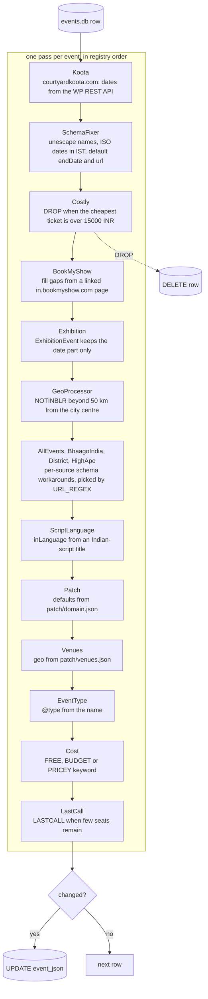

# HACKING

This project requires Python 3.14 and uses `uv` to manage its dependencies.

## Setup
```
uv sync --frozen --extra test
```

Run the complete ingestion pipeline with the same Makefile entry point used by
GitHub Actions:

```
uv run make clean && uv run make -s all
```

To import already-fetched event data into `events.db`, use `src.build`. An
optional `out/` JSON path limits the import to that file:

```
uv run python -m src.build
uv run python -m src.build out/bcc.json
```

Run Python modules from the repository root with `python -m src.<module>`.
Use `src.*` for absolute project imports; relative imports within a `src`
package are also valid. No `PYTHONPATH` setup is needed.

To add or change an event source, see [SOURCES.md](SOURCES.md).

## Processors

Post-processing logic in `src/processors/`, run after the build in the order of `PROCESSORS` in `registry.py`; add new classes there in order.
Any exception stops the run, so handle known bad data and log a warning with the URL.

```python
from .base import Processor

class MyProcessor(Processor):
    URL_REGEX = r"https://example\.com/.*"  # Optional: filter by URL

    @staticmethod
    def process(url, event):
        # Modify event dict
        event["keywords"] = event.get("keywords", []) + ["TAG"]
        return event
```

`URL_REGEX` is matched against the row's `url` column, so only matching
sources see that processor. Returning `DROP` deletes the row and stops the
chain; any other change is written back. `IgnoredEvents` drops listed ids
and is empty today.



## Event types and tags

- **Sources** set a specific `@type` when they know it.
- **Source processors** (AllEvents, District, HighApe, Koota, BhaagoIndia) fix one source's data, such as a type it stamps on everything.
- **`eventtype.py`** owns general typing from names, descriptions and keywords, and only fills a missing or plain `Event` type.
- **`src/tagger.py`** owns activity tags from `src/common/activities.py`: name rules, Jev answers, KIDS, MOVIE-SCREENING and WOMEN-ONLY, plus Jev typing for events still left as `Event`. It skips events with an `EXCLUDE` tag, and reads the same names as `eventtype.py` for tags instead of types, so their rules overlap on purpose.
- **`post-build.sql`** runs between the processors and the tagger and owns curation: exclusion and quality tags, area and source tags, ONLINE, BSF/MULTIDAY, CURATED, data fixes, deletions and keyword cleanup. It keeps specific type or tag overrides for named events, venues and organisers; general rules for types and activity tags go in `eventtype.py` and the tagger. Its `->>` needs SQLite 3.38.
